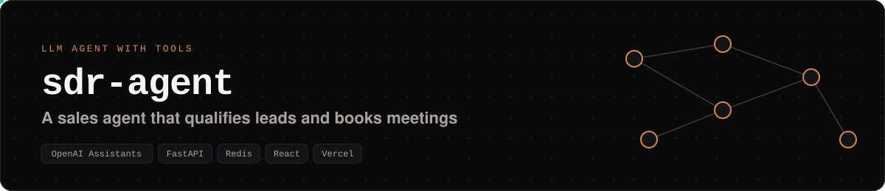
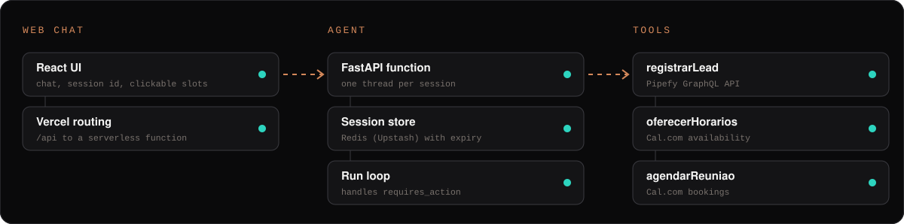

<div align="center">

<picture>
  <source media="(prefers-color-scheme: dark)" srcset="util/readme/banner-dark.svg">
  <source media="(prefers-color-scheme: light)" srcset="util/readme/banner-light.svg">
  
</picture>

      

**English** · [Português](README.pt-BR.md)

</div>

## What it does

An **LLM agent that works as a sales development representative (SDR)** in a web chat. It talks to a lead, collects their details, records them in a CRM, offers real available time slots and books the meeting, all through **tool calls** to real APIs.

https://github.com/user-attachments/assets/abf15d7a-89ba-4ab4-9c88-c3d1a7b727c5

Built as a technical challenge. The public deployment has been turned off; the video above shows it running.

## How it works

<picture>
  <source media="(prefers-color-scheme: dark)" srcset="util/readme/pipeline-dark.svg">
  <source media="(prefers-color-scheme: light)" srcset="util/readme/pipeline-light.svg">
  
</picture>

1. The **React chat** sends each message with a session id to `/api/chat`.
2. A **FastAPI serverless function** looks up the conversation thread for that session in **Redis** (or creates one, with an expiry).
3. It runs the **OpenAI Assistant** on the thread. While the run reports `requires_action`, the backend executes the requested tool and submits the result back to the model.
4. When the run completes, the final answer goes back to the chat.

### Tools the agent can call

| Tool | What it does | API |
|---|---|---|
| `registrarLead` | Creates or updates the lead card (name, email, company, need, meeting link) | Pipefy GraphQL |
| `oferecerHorarios` | Fetches available slots and shows them in the São Paulo time zone | Cal.com `/availability` |
| `agendarReuniao` | Books the chosen slot and returns the meeting link | Cal.com `/bookings` |

Time zones are handled in the backend: the agent shows times in `America/Sao_Paulo` and stores them in UTC.

### API

| Method | Route | Purpose |
|---|---|---|
| `POST` | `/api/chat` | Send a message and get the agent's reply |
| `POST` | `/api/session` | Create a new session id |
| `GET` | `/api/history/{session_id}` | Conversation history |
| `POST` | `/api/session/{session_id}/reset` | Reset a session |
| `GET` | `/api/health` | Health check, including Redis |

## Run it locally

You need Python 3.10+, [Poetry](https://python-poetry.org/), Node.js 16+, a Redis instance and API keys for OpenAI, Pipefy and Cal.com (see `.env` in [the Portuguese README](README.pt-BR.md#configuração-e-deploy)).

```bash
# 1. create the OpenAI Assistant once; it writes the id to api/.env, copy it to the root .env
cd api && poetry install --no-root && poetry run python create_assistant.py && cd ..

# 2. backend
uvicorn api.index:app --host 0.0.0.0 --port 8000

# 3. frontend (in another terminal)
cd frontend && npm install && npm start
```

Docker Compose files are also included (`Dockerfile.backend`, `Dockerfile.frontend`, `nginx.conf`). The `deploy-vercel` branch holds the serverless deployment setup.

## Stack

- **Backend:** Python, FastAPI (serverless on Vercel), OpenAI Assistants API, Redis (Upstash), httpx, python-dateutil
- **Frontend:** React (hooks), Fetch API
- **Integrations:** Pipefy (GraphQL), Cal.com API v1

## What I would add next

- Automated tests for the tool-calling loop and an evaluation set of conversations.
- Retries and timeouts around external APIs.
- Tracing of each run (latency, tokens, cost).

Built by **[Oséias Farias](https://github.com/Oseiasdfarias)**.
